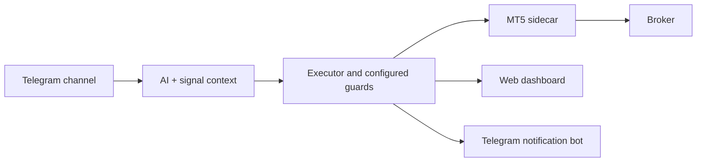

<p></p>

# LV Copytrader

[Official website](https://lvenc.site) · [Product film](https://lvenc.site/assets/showcase/film/index.html) · [Interactive story](https://lvenc.site/assets/showcase/ru/index.html)

**Telegram signals → AI interpretation → MetaTrader 5 execution.**

LV Copytrader is a self-hosted trading assistant with a web dashboard. It reads a Telegram
channel you select, interprets text and chart images with an AI provider, and manages orders
on your own MetaTrader 5 account. Telegram notifications show what opened, which target was
hit, and what happened to the remaining positions.

**Public MVP · v0.1.0 · Apache-2.0**

[What changed](CHANGELOG.md) · [Architecture](docs/ARCHITECTURE.md) ·
[Operations](RUNBOOK.md) · [Telegram cards](docs/TELEGRAM-NOTIFICATIONS.md)

## What it does

| Feature | Behavior |
| --- | --- |
| Telegram intake | Reads text, images, edits and follow-up messages from configured sources |
| AI interpretation | Converts the signal and context into trading actions; records decisions in the dashboard |
| MT5 execution | Opens market/pending orders and manages SL, TP, changes and closes |
| Multiple targets | Supports ordinary split entries and ladder cover/runner management |
| Break even | Can protect remaining positions after the first target, following the selected policy |
| Clear notifications | One entry card for positions in the same signal run; separate TP, SL, break-even and error states |
| Recovery | Reconciles positions and history after startup/reconnect |
| Operator controls | Arm/disarm, configurable limits, trade history and an emergency stop |



The channel reader uses your Telegram **user session**. The optional notification bot is a
separate **Bot API token**. An AI provider account and an MT5 broker account are also needed;
the public repository includes no credentials, sessions, or owner data.

## Quick start — Linux x86-64

You need Git, Docker Engine with Compose v2, a Telegram account/API credentials,
a supported AI provider, and an MT5 account. Start with a demo account.

```sh
git clone https://github.com/abdulloh5007/lv-copytrader-public.git
cd lv-copytrader-public
cp .env.example .env
```

Edit `.env` before starting:

- Generate `SECRET_KEY` once with the command below. Keep it with your database.
- Set a strong unique `SIDECAR_TOKEN` and `SP_AUTH_PASSWORD`; missing credentials keep private APIs locked.
- Set `SP_ALLOWED_HOSTS` to your domain plus `localhost,127.0.0.1` for health checks.
- Leave `SP_ALLOW_UNAUTHENTICATED=false` for every public deployment.
- Fill in `MT5_LOGIN`, `MT5_PASSWORD`, and your exact `MT5_SERVER` name.
- For brokers requiring their own MT5 installer, set `MT5_INSTALLER_URL` accordingly.

```sh
python3 -c 'import base64,secrets; print(base64.urlsafe_b64encode(secrets.token_bytes(32)).decode())'

# Compose uses explicitly named external volumes; create them on a fresh installation.
docker volume create lvct_lvCT-data
docker volume create lvct_lvCT-mt5-config
docker volume create lvct_lvCT-x11

docker compose up -d --build
```

Open **http://localhost:8000** on the VPS, or use an SSH tunnel from your computer:

```sh
ssh -L 8000:127.0.0.1:8000 user@your-vps
```

Sign in with `SP_AUTH_USER` / `SP_AUTH_PASSWORD`, connect Telegram, select your signal channel,
configure the AI provider and optional notification bot, then verify the MT5 account in
Settings. The first Wine/MT5 installation can take several minutes. Leave trading disarmed
until the connection and settings are checked; then arm it explicitly.

The sidecar's trading RPC stays inside Docker. The dashboard binds to loopback by default.
For a public domain, configure an authenticated reverse proxy or the optional tunnel profile;
see [RUNBOOK.md](RUNBOOK.md).

### ARM64 VPS

The backend runs natively on ARM64; Windows MT5 requires the tested FEX/Wine runtime and
pinned sidecar image. Follow [the ARM64 guide](deploy/arm64/README.md). ARM64 setup is a separate
path with additional runtime/image prerequisites; the x86-64 quick start is not sufficient.

## Example notification

```text
🟢 ВХОД — BUY XAUUSD
Режим Обычный
Объём 0.20 + 0.20 = 0.40
1 · 2380.00 · SL 2370.00 · TP 2390.00
2 · 2380.00 · SL 2370.00 · TP 2400.00
После TP1 — остаток в б/у
```

The actual bot uses native Telegram RichMessage cards, with a classic HTML fallback when the
API explicitly refuses that method/format. A TP card reports break even only after the stop
change is confirmed. Live TP/SL checks follow `SL_WATCHDOG_SECONDS` (60 seconds by default).

## Development

Backend: Python 3.12+, FastAPI, SQLAlchemy/SQLite, Telethon and HTTP Bot API.
Frontend: React, TypeScript and Vite. The MT5 SDK runs in the separate Windows/Wine sidecar.

```sh
python3 -m venv .venv
. .venv/bin/activate
pip install -c backend/requirements.lock -e './backend[dev]'
python -m pytest backend/tests -q

cd frontend
npm ci
npm run typecheck
npm test
npm run build
```

Tests use a fake MT5 broker and do not require a live trading account. Every release is recorded
in [CHANGELOG.md](CHANGELOG.md); `VERSION` and the backend/frontend package versions agree.

## Project layout

```text
backend/        API, AI loop, Telegram ingestion/notifier, trading engine and tests
frontend/       Operator dashboard
mt5-sidecar/    Windows MT5 bridge under Wine
deploy/arm64/   Pinned ARM64/FEX runtime preparation
docs/           Architecture, contracts and operating notes
```

## Limits and license

This is an MVP, not a profit guarantee. AI can misread a signal or image, channels can be late,
and broker execution can fail or slip. Test on demo and review the controls before enabling
real trading. You are responsible for your broker account and access to the signal channel.

Licensed under [Apache-2.0](LICENSE). See [NOTICE](NOTICE) for trading risk and third-party terms.
LV Copytrader is not affiliated with Telegram, MetaQuotes, or any broker.
